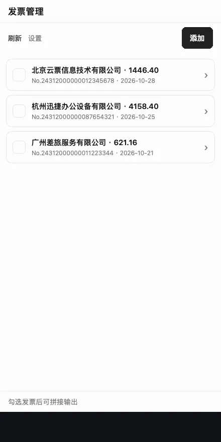
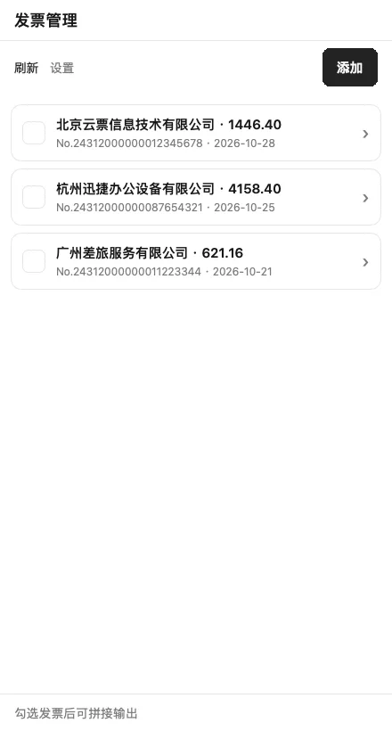
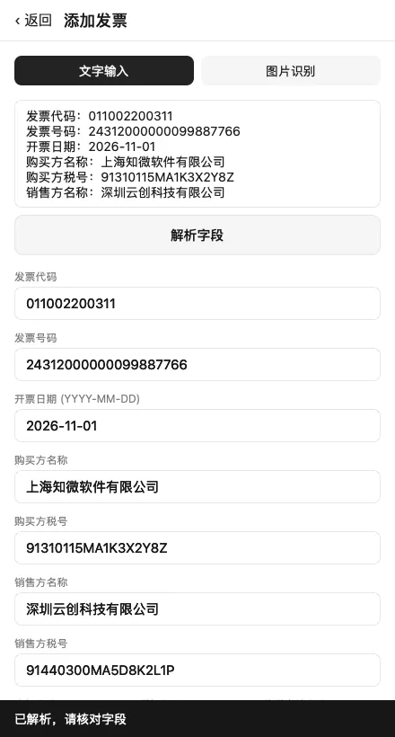
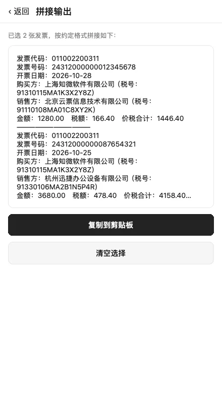
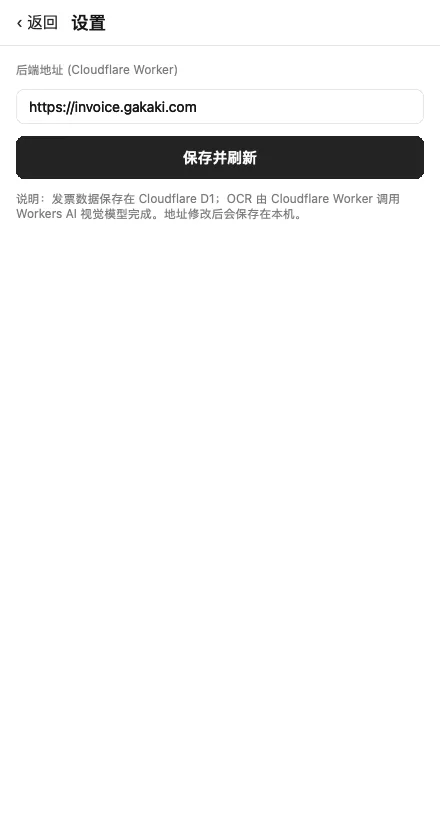
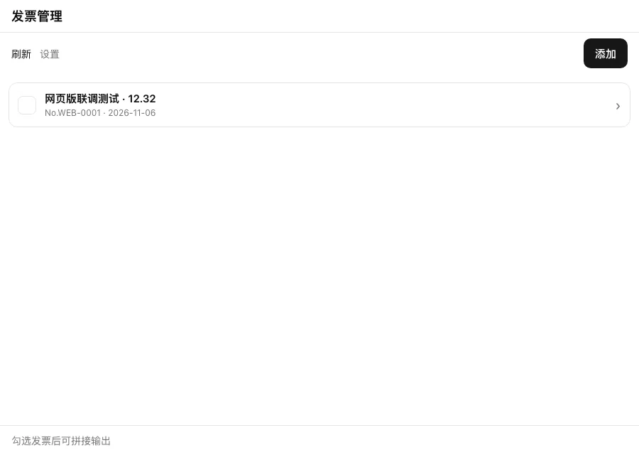

# 发票管理

兼容 macOS 桌面、Android 手机与**网页**的发票管理应用：输入文字、选择或拍摄发票图片做 OCR，按指定格式拼接文字，支持多选发票批量输出。数据持久化在 Cloudflare D1，OCR 由 Cloudflare Workers AI 完成。

网页版（无需安装）：**<https://web.gakaki.com>** —— 同一个 Rust root 由 `nsh package --target web` 编译为 WASM 静态站点，部署在 Cloudflare Workers 静态资源上，与原生端共用同一套 D1 数据。



> 8.8 秒循环演示：发票列表 → 粘贴文字自动解析字段 → 多选拼接输出 → 设置后端地址（中文字幕，动画 WebP）。

**当前版本真实界面截图**（macOS 窗口实拍，WebP）：

| 发票列表 · 增删改查 | 录入 · 文字解析 / 图片 OCR |
|---|---|
|  |  |

| 多选 · 按格式拼接输出 | 设置 · 后端地址与 D1 |
|---|---|
|  |  |

**网页版**（Chrome 实拍，与上面原生端同一份代码 / 同一份 D1 数据）：



## 下载

打开下载页：**<https://invoice.gakaki.com>** —— 列出各平台安装包、可点击链接与扫码二维码；也可直接前往 [GitHub Releases](https://github.com/gakaki/invoice-manager/releases)。

- **macOS** `.dmg`：ad hoc 签名、未公证。首次打开请右键 → 打开，或在「系统设置 → 隐私与安全性」中允许。
- **Android** `.apk`：使用 debug keystore 签名，需在系统设置中允许安装未知来源应用。

## 功能

- **三种录入**：直接输入 / 粘贴文字（启发式解析字段）、选择图片、Android 系统相册选择器自带相机拍摄。
- **云端 OCR**：Worker 调用 Workers AI 视觉模型，抽取发票代码、号码、开票日期、购销双方名称及税号、金额、税额、价税合计。
- **发票管理**：列表、新增、编辑、删除。查询均带索引、显式列与 `LIMIT` 分页，控制 Cloudflare D1 每日行读取额度。
- **多选拼接输出**：勾选多张发票，按约定格式拼接为文本并一键复制到剪贴板。
- **设置**：可修改后端 API 地址，保存在本机。

## 结构

| 目录 | 内容 |
|---|---|
| `app/` | Rust + [Native Shell (nsh.dev)](https://nsh.dev) 跨平台客户端，UI 在 `src/lib.rs` |
| `worker/` | Cloudflare Worker（REST CRUD + Workers AI OCR）、D1 迁移、静态下载页 |

## 本地开发

按全局 `AGENTS.md` 的 Rust 规则，构建默认使用 **mbx**（跨 worktree 共享 Cargo 构建缓存）与 **blaze**（增量编译）：

```sh
cd app
mbx check                    # 共享缓存构建
blaze check                  # 增量编译检查
nsh test                     # headless UI 测试
nsh package --target macos   # .nsh/out/发票管理.app
nsh package --target android # .nsh/out/发票管理.apk
nsh package --target web     # .nsh/out/发票管理/ 静态站点（需 llvm-ar 在 PATH）

cd ../worker
npm install
npm run check                # tsc --noEmit
npx wrangler dev             # 本地调试（--local D1）
```

也可直接 `cargo run`（macOS/Windows/Linux 桌面后端）、`nsh run`（热重载）。

**截图与演示动图可复现**：`app/Screenshots.test.tsx` 在真实 macOS 窗口渲染四个界面（headless 下自动跳过，CI 不报错），输出 `assets/screenshots/*.png`；转成 WebP（`cwebp -q 82`）并删除原 PNG，再用 ffmpeg 给每帧加中文字幕、`img2webp -loop 0 -d 2200 -lossy -q 78` 合成 `assets/demo.webp`。UI 变化后重跑一次即可同步更新。

## 部署

后端已部署在自定义域名 **<https://invoice.gakaki.com>**（不使用 `*.workers.dev`）。配置见 `worker/wrangler.jsonc`：D1 数据库 `invoice-db`、Workers AI 绑定、静态资源目录 `public/`。

```sh
cd worker
npx wrangler d1 migrations apply invoice-db --remote
npx wrangler deploy
npx wrangler deploy --dry-run   # 发布前校验绑定
```

网页版部署在自定义域名 **<https://web.gakaki.com>**，是一个纯静态资源 Worker（配置 `worker/wrangler.web.jsonc`）。一条命令即可重建并发布：

```sh
./worker/deploy-web.sh
# nsh package --target web → 只保留未压缩文件到 worker/web-public/ → wrangler deploy
```

脚本会把 Rust root 编译成 `nsh.<hash>.wasm` + 内容命名的 JS，并自动把 rustup 的 `llvm-ar`（`llvm-tools` 组件）加入 PATH —— wasm 构建时 cc-rs 需要它。`.gz` / `.br` 预压缩副本不上载，Cloudflare 会按 `Accept-Encoding` 实时压缩。

推送 `v*` 版本标签会触发 `.github/workflows/release.yml`：运行 `nsh test`，构建 macOS `.dmg` 与 Android `.apk`，生成 SHA-256 校验文件并上传到同标签的 GitHub Release。下载页通过 GitHub Releases API 自动列出最新版本的安装包。

> 技术栈：Rust · Native Shell (nsh.dev) · mbx · blaze · Cloudflare D1 / Workers AI / Workers。
